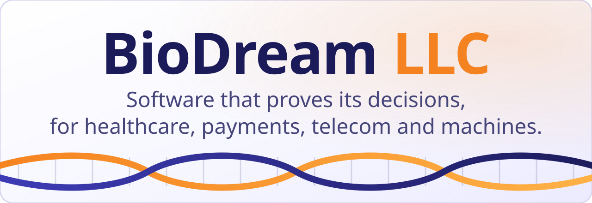
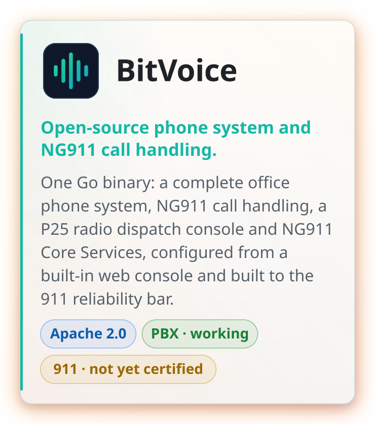
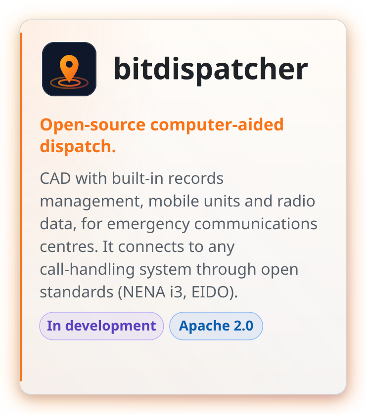
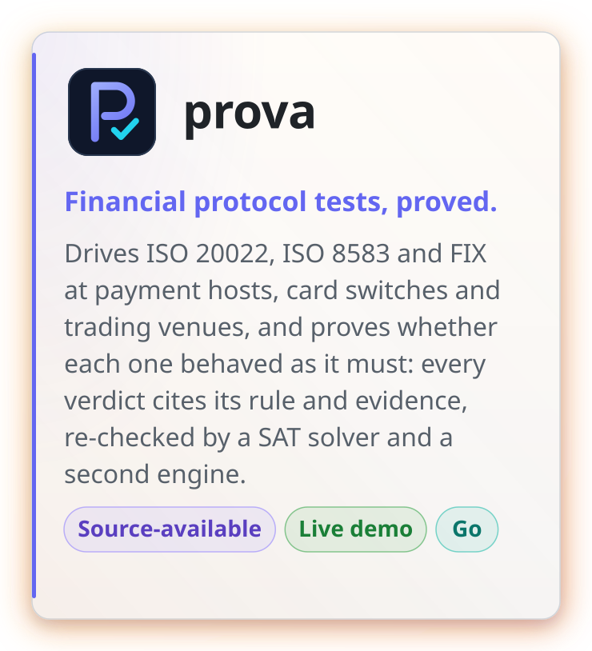
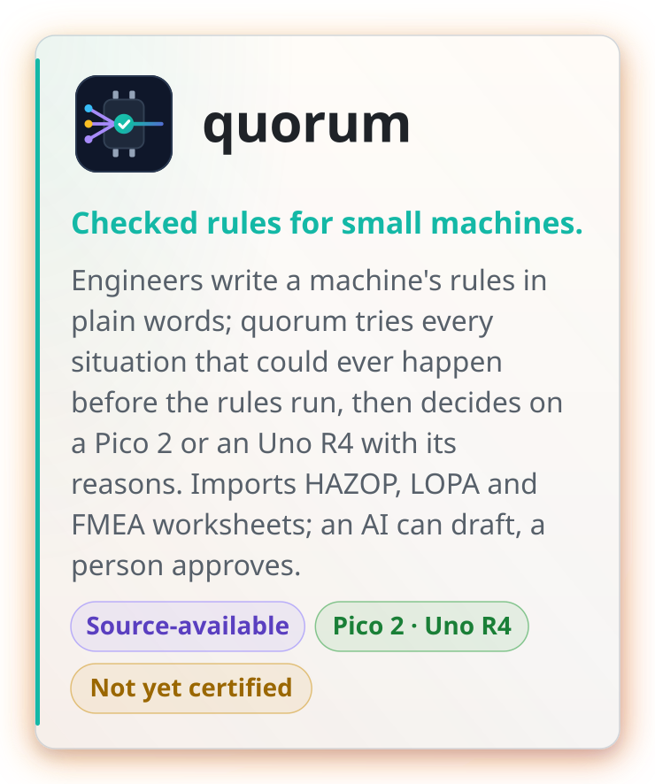
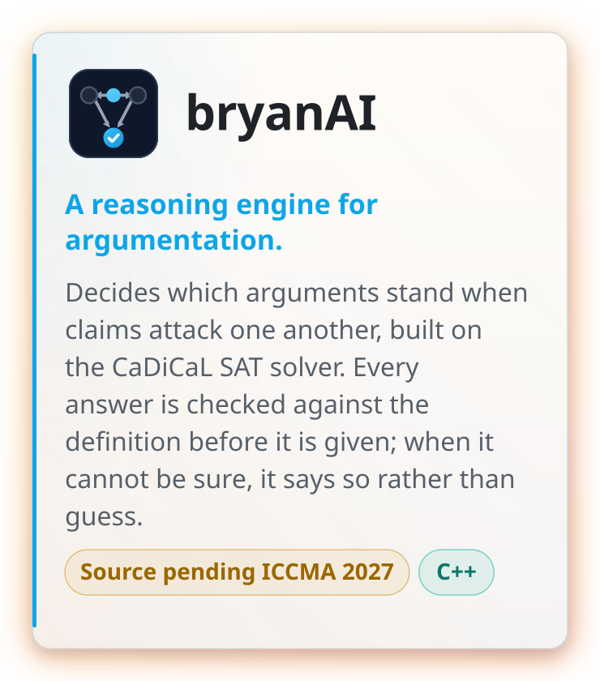
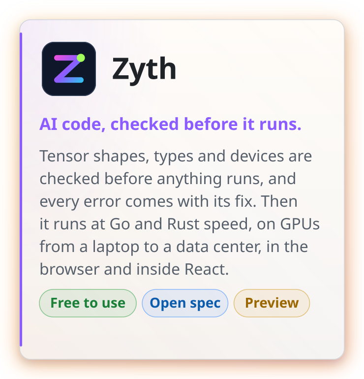

<a href="https://biodream.ai"><picture><source media="(prefers-color-scheme: dark)" srcset="https://raw.githubusercontent.com/BioDream-LLC/.github/main/profile/assets/gen/banner-dark.svg?v=5"></picture></a>

**Software whose decisions come with proof.**

## One idea, applied where decisions matter

Most software that decides something (approve or deny, pass or fail, route or stop) gives an answer and leaves
you to trust it. BioDream builds software that shows why. **Every decision cites the rule it applied and the
evidence it rests on, and missing evidence is never treated as evidence.** When the facts do not settle a
question, the software says so and names what would.

The same way of deciding, grounded argumentation checked against every case it can be given, runs through
everything here:

- **Healthcare.** Vaglio decides prior authorization and cannot deny care without proving why. It sits behind
  Perfuse, the integration engine that moves the clinical data.
- **Telecom and 911.** BitVoice routes calls with a rulebook that explains every route it takes, built to a 911
  reliability bar. bitdispatcher, the dispatch system, sends the
  units, with an offline map and a screen for every monitor.
- **Payments and trading.** prova proves whether a payment host, card switch or trading venue gave the right
  answer, not just a well-formed one.
- **Machines.** quorum checks a machine's rules against every situation before they run, then decides on an
  $11 chip with its reasons.
- **AI work.** Zyth is a programming language that checks a model's tensor shapes before it runs, and
  says where every number came from and how to fix it.
- **The core.** bryanAI is the argumentation engine, built on the CaDiCaL SAT solver.
- **News.** Hyper News sorts the world's news by what happened, and calls a figure confirmed only when two
  independent reports agree.

## Who builds it

**BioDream Developer**, founder of BioDream LLC, has worked for over 30 years in healthcare, telecommunications and
911. The products here come from that work: the problems hospitals, health plans, phone systems and emergency
communications centres keep running into, solved in a way that can be checked.

Questions, pilots and commercial licences: [**firstmind@biodream.ai**](mailto:firstmind@biodream.ai)

## Products

### Healthcare

<a href="https://github.com/BioDream-LLC/perfuse"><picture><source media="(prefers-color-scheme: dark)" srcset="https://raw.githubusercontent.com/BioDream-LLC/.github/main/profile/assets/gen/card-perfuse-dark.svg?v=5"></picture></a>
<a href="https://github.com/BioDream-LLC/vaglio"><picture><source media="(prefers-color-scheme: dark)" srcset="https://raw.githubusercontent.com/BioDream-LLC/.github/main/profile/assets/gen/card-vaglio-dark.svg?v=5"></picture></a>

### Telecom and public safety

<a href="https://github.com/BioDream-LLC/bitvoice"><picture><source media="(prefers-color-scheme: dark)" srcset="https://raw.githubusercontent.com/BioDream-LLC/.github/main/profile/assets/gen/card-bitvoice-dark.svg?v=6"></picture></a>
<a href="https://github.com/BioDream-LLC/bitdispatcher"><picture><source media="(prefers-color-scheme: dark)" srcset="https://raw.githubusercontent.com/BioDream-LLC/.github/main/profile/assets/gen/card-bitdispatcher-dark.svg?v=8"></picture></a>

### Payments and machines

<a href="https://github.com/BioDream-LLC/prova"><picture><source media="(prefers-color-scheme: dark)" srcset="https://raw.githubusercontent.com/BioDream-LLC/.github/main/profile/assets/gen/card-prova-dark.svg?v=4"></picture></a>
<a href="https://github.com/BioDream-LLC/quorum"><picture><source media="(prefers-color-scheme: dark)" srcset="https://raw.githubusercontent.com/BioDream-LLC/.github/main/profile/assets/gen/card-quorum-dark.svg?v=9"></picture></a>

### The reasoning core, and BioDream on your phone

<a href="https://github.com/BioDream-LLC"><picture><source media="(prefers-color-scheme: dark)" srcset="https://raw.githubusercontent.com/BioDream-LLC/.github/main/profile/assets/gen/card-bryanai-dark.svg?v=3"></picture></a>
<a href="https://biodream.ai"><picture><source media="(prefers-color-scheme: dark)" srcset="https://raw.githubusercontent.com/BioDream-LLC/.github/main/profile/assets/gen/card-biodream-dark.svg?v=10"></picture></a>

### For developers and news

<a href="https://github.com/BioDream-LLC/zyth"><picture><source media="(prefers-color-scheme: dark)" srcset="https://raw.githubusercontent.com/BioDream-LLC/.github/main/profile/assets/gen/card-zyth-dark.svg?v=2"></picture></a>
<a href="https://hyper-news.com"><picture><source media="(prefers-color-scheme: dark)" srcset="https://raw.githubusercontent.com/BioDream-LLC/.github/main/profile/assets/gen/card-hypernews-dark.svg?v=2"></picture></a>

| | |
|---|---|
| **Perfuse** | [perfuse.health](https://perfuse.health) · [Source](https://github.com/BioDream-LLC/perfuse) · [Download](https://github.com/BioDream-LLC/perfuse/releases/latest) |
| **Vaglio** | [Try the demo](https://vaglio.perfuse.health:8443) · [Source](https://github.com/BioDream-LLC/vaglio) · [In plain words (slides)](https://github.com/BioDream-LLC/vaglio/raw/main/docs/Vaglio-overview.pptx) · [Works with Perfuse](https://github.com/BioDream-LLC/vaglio#behind-perfuse) |
| **BitVoice** | [bitvoice.org](https://bitvoice.org) · [Source](https://github.com/BioDream-LLC/bitvoice) · [Everything it does](https://github.com/BioDream-LLC/bitvoice#everything-it-does) |
| **bitdispatcher** | [bitdispatcher.com](https://bitdispatcher.com) · [Try the demo](https://demo.bitdispatcher.com) · [Source](https://github.com/BioDream-LLC/bitdispatcher) · [Everything it does](https://github.com/BioDream-LLC/bitdispatcher#everything-it-does) · [The manual (PDF)](https://github.com/BioDream-LLC/bitdispatcher/blob/main/docs/manual/bitdispatcher-manual.pdf) |
| **prova** | [Try the demo](https://prova.perfuse.health:9443) · [Source](https://github.com/BioDream-LLC/prova) · [The manual](https://prova.perfuse.health:9443/manual) |
| **quorum** | [Source](https://github.com/BioDream-LLC/quorum) · [In plain words (slides)](https://github.com/BioDream-LLC/quorum/blob/main/docs/quorum.pdf) · [Download the studio](https://github.com/BioDream-LLC/quorum/releases/latest) |
| **bryanAI** | Source pending results of the 2027 ICCMA contest |
| **BioDream** | [biodream.ai](https://biodream.ai) · [Google Play](https://play.google.com/store/apps/details?id=com.biodream.anima) |
| **Zyth** | [zyth.io](https://zyth.io) · [Try it in your browser](https://zyth.io/play/) · [Spec, libraries and package tools](https://github.com/BioDream-LLC/zyth) · [The specification](https://github.com/BioDream-LLC/zyth/blob/main/ZYTH-SPEC.md) |
| **Hyper News** | [hyper-news.com](https://hyper-news.com) · [Corrections](https://hyper-news.com/corrections) |

## What we hold ourselves to

- ✅ **Proven, not promised.** Every decision carries its proof, and every product is tested against real software and published conformance suites, not mocks. We say plainly what is not done yet.
- 🧩 **Open where it counts.** Infrastructure that hospitals and emergency services depend on is Apache-2.0, with no paid modules and no licence meters, and anyone may fork it. Vaglio's source is published too, free for any health plan to run. quorum's source is published for any noncommercial use, and prova's is free for any small business; commercial licences are available for both. Zyth's specification, standard library and package tools are Apache-2.0 or MIT, and its compiler is free to use.
- 🔒 **Your data stays yours.** Our engines run on your servers, and the BioDream app runs its AI on the phone. Nothing is sent to us that we do not need.

[**biodream.ai**](https://biodream.ai) · [**perfuse.health**](https://perfuse.health) · [**bitvoice.org**](https://bitvoice.org) · [**bitdispatcher.com**](https://bitdispatcher.com) · [**hyper-news.com**](https://hyper-news.com) · [**zyth.io**](https://zyth.io) · [**firstmind@biodream.ai**](mailto:firstmind@biodream.ai)

BioDream LLC · United States

